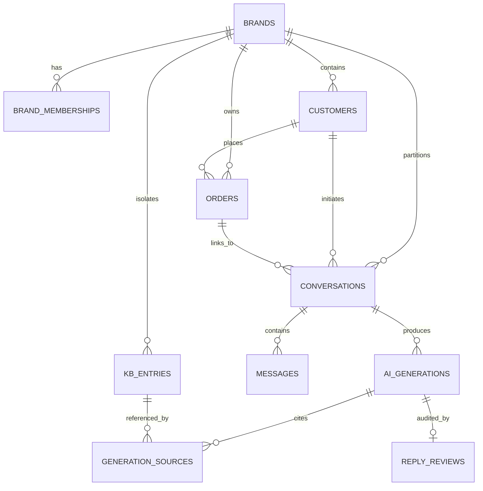

# Database Architecture & Schema Specification

This document provides the complete database schema design, entity relationships, Row-Level Security (RLS) policies, and indexing strategies for the **Datastraw CX Reply Assistant** platform.

---

## 1. Entity-Relationship (ER) Diagram



---

## 2. Core Tables Specification

The schema consists of 10 normalized tables engineered for multi-tenant isolation via a mandatory `brand_id UUID` foreign key.

### 2.1 `brands` (Tenant Root)
Master tenant records defining brand identity and policy parameters.
| Column | Type | Constraints | Description |
| :--- | :--- | :--- | :--- |
| `id` | `UUID` | `PRIMARY KEY, DEFAULT gen_random_uuid()` | Unique tenant identifier. |
| `name` | `TEXT` | `NOT NULL, UNIQUE` | Brand display name (e.g., "Shein Designs", "Watford Leathers"). |
| `slug` | `TEXT` | `NOT NULL, UNIQUE` | URL-safe slug (`shein-designs`, `watford-leathers`). |
| `created_at` | `TIMESTAMPTZ` | `NOT NULL, DEFAULT now()` | Timestamp of tenant creation. |

### 2.2 `brand_memberships` (RBAC)
Maps authenticated users (agents & administrators) to brand tenants.
| Column | Type | Constraints | Description |
| :--- | :--- | :--- | :--- |
| `id` | `UUID` | `PRIMARY KEY, DEFAULT gen_random_uuid()` | Membership record ID. |
| `brand_id` | `UUID` | `FK -> brands(id) ON DELETE CASCADE` | Associated brand. |
| `user_id` | `UUID` | `NOT NULL` | Supabase auth user UUID. |
| `role` | `TEXT` | `CHECK (role IN ('agent', 'admin'))` | Role tier determining permissions. |
| `created_at` | `TIMESTAMPTZ` | `NOT NULL, DEFAULT now()` | Membership creation date. |
*Constraints:* `UNIQUE(brand_id, user_id)`.

### 2.3 `customers` (Multi-Tenant Scoped)
Customers scoped strictly to a specific brand tenant.
| Column | Type | Constraints | Description |
| :--- | :--- | :--- | :--- |
| `id` | `UUID` | `PRIMARY KEY, DEFAULT gen_random_uuid()` | Unique customer ID. |
| `brand_id` | `UUID` | `FK -> brands(id) ON DELETE CASCADE` | Owning brand. |
| `name` | `TEXT` | `NOT NULL` | Customer full name. |
| `email` | `TEXT` | `NULLABLE` | Customer contact email. |
| `phone` | `TEXT` | `NULLABLE` | Customer phone number. |
| `created_at` | `TIMESTAMPTZ` | `NOT NULL, DEFAULT now()` | Registration timestamp. |
*Constraints:* `UNIQUE(id, brand_id)`.

### 2.4 `orders` (E-Commerce Purchase Records)
Purchase records tracking status, delivery timestamps, and order line items.
| Column | Type | Constraints | Description |
| :--- | :--- | :--- | :--- |
| `id` | `UUID` | `PRIMARY KEY, DEFAULT gen_random_uuid()` | Order record ID. |
| `brand_id` | `UUID` | `FK -> brands(id) ON DELETE CASCADE` | Brand identifier. |
| `customer_id` | `UUID` | `FK -> customers(id, brand_id)` | Customer placing the order. |
| `order_number` | `TEXT` | `NOT NULL` | Brand-prefixed reference (e.g., `SD-1001`, `WL-2001`). |
| `status` | `TEXT` | `CHECK (status IN ('processing', 'shipped', 'delivered', 'cancelled', 'returned'))` | Lifecycle stage. |
| `delivered_at` | `TIMESTAMPTZ` | `NULLABLE` | Anchor date used to evaluate return eligibility windows. |
| `items_json` | `JSONB` | `NOT NULL, DEFAULT '[]'` | Ordered items with item names, prices, tags, and SKUs. |
| `total_amount` | `NUMERIC(10,2)`| `NOT NULL, DEFAULT 0.00` | Order total monetary value. |
| `currency` | `TEXT` | `NOT NULL, DEFAULT 'USD'` | Currency code (USD, EUR, GBP). |
*Constraints:* `UNIQUE(brand_id, order_number)`, `UNIQUE(id, brand_id)`.

### 2.5 `conversations` (Support Ticket Threads)
Customer support inquiries and ongoing message threads.
| Column | Type | Constraints | Description |
| :--- | :--- | :--- | :--- |
| `id` | `UUID` | `PRIMARY KEY, DEFAULT gen_random_uuid()` | Thread ID. |
| `brand_id` | `UUID` | `FK -> brands(id) ON DELETE CASCADE` | Brand owner. |
| `customer_id` | `UUID` | `FK -> customers(id, brand_id)` | Customer in thread. |
| `order_id` | `UUID` | `FK -> orders(id, brand_id) ON DELETE SET NULL` | Linked order for contextual verification. |
| `status` | `TEXT` | `CHECK (status IN ('open', 'pending_approval', 'resolved', 'closed'))` | Current ticket status. |
| `version` | `INTEGER` | `NOT NULL, DEFAULT 1` | Optimistic concurrency control lock. |
| `created_at` | `TIMESTAMPTZ` | `NOT NULL, DEFAULT now()` | Thread open date. |
| `updated_at` | `TIMESTAMPTZ` | `NOT NULL, DEFAULT now()` | Last update timestamp. |

### 2.6 `messages` (Message Stream)
Ordered sequence of customer questions, AI suggested drafts, and agent replies.
| Column | Type | Constraints | Description |
| :--- | :--- | :--- | :--- |
| `id` | `UUID` | `PRIMARY KEY, DEFAULT gen_random_uuid()` | Message ID. |
| `conversation_id`| `UUID` | `FK -> conversations(id) ON DELETE CASCADE` | Parent thread. |
| `brand_id` | `UUID` | `FK -> brands(id) ON DELETE CASCADE` | Brand owner. |
| `sender_type` | `TEXT` | `CHECK (sender_type IN ('customer', 'agent', 'ai_assistant', 'system'))` | Sender entity. |
| `body` | `TEXT` | `NOT NULL` | Message textual content. |
| `created_at` | `TIMESTAMPTZ` | `NOT NULL, DEFAULT now()` | Timestamp. |

### 2.7 `kb_entries` (Knowledge Base & Vector Embeddings)
Brand-isolated return policies, shipping rules, and FAQ articles.
| Column | Type | Constraints | Description |
| :--- | :--- | :--- | :--- |
| `id` | `UUID` | `PRIMARY KEY, DEFAULT gen_random_uuid()` | Knowledge chunk ID. |
| `brand_id` | `UUID` | `FK -> brands(id) ON DELETE CASCADE` | Owning brand. |
| `category` | `TEXT` | `NOT NULL` | Category (`return_policy`, `shipping`, `warranty`). |
| `title` | `TEXT` | `NOT NULL` | Policy rule title. |
| `content` | `TEXT` | `NOT NULL` | Exact policy text used for LLM context injection. |
| `embedding` | `vector(1536)` | `NULLABLE` | `text-embedding-3-small` dense vector representation. |
| `metadata` | `JSONB` | `DEFAULT '{}'` | Metadata (chunk index, max return days, condition rules). |

### 2.8 `ai_generations` (AI Inference Telemetry)
Complete log of all AI suggested replies before human agent modification.
| Column | Type | Constraints | Description |
| :--- | :--- | :--- | :--- |
| `id` | `UUID` | `PRIMARY KEY, DEFAULT gen_random_uuid()` | AI generation ID. |
| `conversation_id`| `UUID` | `FK -> conversations(id) ON DELETE CASCADE` | Thread ID. |
| `model_id` | `TEXT` | `NOT NULL` | Model name (`gemini-1.5-flash`, `gpt-4o`). |
| `suggested_reply`| `TEXT` | `NOT NULL` | Raw model output. |
| `confidence` | `NUMERIC(3,2)`| `NOT NULL CHECK (confidence BETWEEN 0 AND 1)` | Model confidence score. |
| `latency_ms` | `INTEGER` | `NOT NULL` | Time to complete inference. |
| `prompt_tokens` | `INTEGER` | `NULLABLE` | Ingestion token count. |
| `completion_tokens`| `INTEGER` | `NULLABLE` | Output token count. |

### 2.9 `reply_reviews` (Human-in-the-Loop Audit Trail)
Records agent review decisions, edits, and final dispatches for compliance.
| Column | Type | Constraints | Description |
| :--- | :--- | :--- | :--- |
| `id` | `UUID` | `PRIMARY KEY, DEFAULT gen_random_uuid()` | Audit log ID. |
| `generation_id` | `UUID` | `FK -> ai_generations(id) ON DELETE CASCADE` | Linked generation. |
| `agent_id` | `UUID` | `NOT NULL` | Reviewing agent UUID. |
| `decision` | `TEXT` | `CHECK (decision IN ('approved_as_is', 'edited', 'rejected', 'manual_override'))` | Review outcome. |
| `final_reply` | `TEXT` | `NOT NULL` | Final text dispatched to customer. |
| `created_at` | `TIMESTAMPTZ` | `NOT NULL, DEFAULT now()` | Dispatch timestamp. |

---

## 3. Multi-Tenant Row Level Security (RLS)

PostgreSQL Row-Level Security guarantees that no agent or query can access data outside their authorized `brand_id`.

```sql
-- Security Definer helper: Checks if current user is an active member of brand
CREATE OR REPLACE FUNCTION auth_is_brand_member(p_brand_id UUID)
RETURNS BOOLEAN LANGUAGE sql SECURITY DEFINER STABLE AS $$
  SELECT EXISTS (
    SELECT 1 FROM brand_memberships
    WHERE brand_id = p_brand_id AND user_id = auth.uid()
  );
$$;

-- Enforce isolation on all tables
ALTER TABLE brands ENABLE ROW LEVEL SECURITY;
ALTER TABLE customers ENABLE ROW LEVEL SECURITY;
ALTER TABLE orders ENABLE ROW LEVEL SECURITY;
ALTER TABLE conversations ENABLE ROW LEVEL SECURITY;
ALTER TABLE messages ENABLE ROW LEVEL SECURITY;
ALTER TABLE kb_entries ENABLE ROW LEVEL SECURITY;

CREATE POLICY tenant_isolation_conversations ON conversations
  FOR ALL USING (auth_is_brand_member(brand_id));

CREATE POLICY tenant_isolation_kb ON kb_entries
  FOR ALL USING (auth_is_brand_member(brand_id));
```

---

## 4. Indexing & Query Optimization

| Table | Index Definition | Purpose |
| :--- | :--- | :--- |
| `orders` | `CREATE INDEX idx_orders_lookup ON orders (brand_id, order_number);` | Sub-5ms order context lookup when customer provides reference ID. |
| `conversations` | `CREATE INDEX idx_conv_queue ON conversations (brand_id, status, updated_at DESC);` | Powers agent ticket inbox sorting and unassigned queue filters. |
| `messages` | `CREATE INDEX idx_messages_thread ON messages (conversation_id, created_at ASC);` | Fast sequential rendering of full conversation history. |
| `kb_entries` | `CREATE INDEX idx_kb_hnsw ON kb_entries USING hnsw (embedding vector_cosine_ops);` | Sub-15ms approximate nearest-neighbor vector similarity search. |

---

## 5. Applying the Schema

The complete, executable SQL migrations are located in [`supabase/migrations/`](file:///c:/Users/ASUS/Desktop/cx%20final/supabase/migrations):
- [`001_initial_schema.sql`](file:///c:/Users/ASUS/Desktop/cx%20final/supabase/migrations/001_initial_schema.sql) — Core tables, constraints, foreign keys.
- [`002_rls_policies.sql`](file:///c:/Users/ASUS/Desktop/cx%20final/supabase/migrations/002_rls_policies.sql) — Row-Level Security policies and RBAC roles.
- [`seed.sql`](file:///c:/Users/ASUS/Desktop/cx%20final/supabase/seed.sql) — Test seeds for Shein Designs (`SD-`) and Watford Leathers (`WL-`).

```bash
# Apply with Supabase CLI
supabase db reset

# Or execute directly against local or remote PostgreSQL
psql $DATABASE_URL -f supabase/migrations/001_initial_schema.sql
psql $DATABASE_URL -f supabase/migrations/002_rls_policies.sql
psql $DATABASE_URL -f supabase/seed.sql
```
